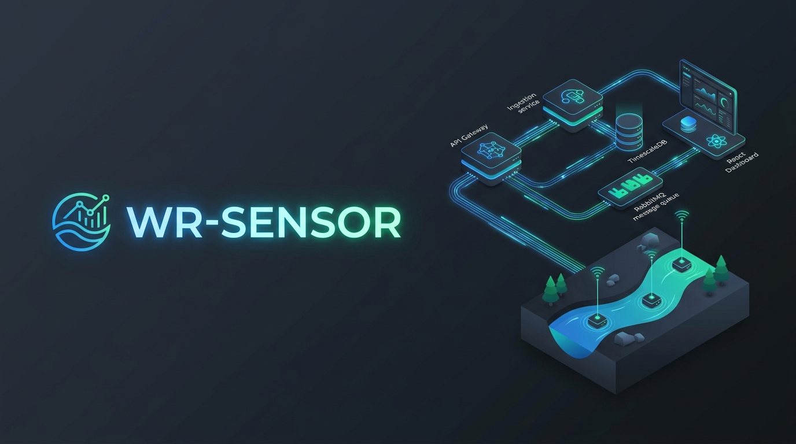

# WR-Sensor — Water Level Monitoring Platform

🇪🇸 [Leer en español](README.es.md)

<p align="center">
  
</p>

<p align="center">
  <a href="https://github.com/CharlyZeta/wr-sensor/actions/workflows/maven-build.yml"></a>
  <a href="docs/REGISTRO-SDD.md"></a>
  
  
  
  
  
</p>

Water level monitoring platform for the Paraná and Salado rivers (Santa Fe, Argentina), built with
**Spec-Driven Development Gate/Loop (SDD-GL)**. Every feature starts as a *Contract*
(`contracts/FEAT-*.md` / `FIX-*.md`) that goes through a human approval Gate (HO-Gate) and then an
autonomous implementation + test Loop until `RESOLVED`.

> Status as of **2026-10-25**: 28 work items closed (19 FEAT + 9 FIX).

---

## Decisions & trade-offs

### 1. Keyset pagination instead of OFFSET

**Decision:** all pagination is keyset (`WHERE id > :cursor`), never `OFFSET`.
**Why:** with OFFSET every page makes the database walk and discard all the previous rows; on a
time-series table that grows without a ceiling, the cost grows with the page number.
**Cost:** you cannot jump to an arbitrary page and the client has to carry the cursor. For infinite
scroll it was acceptable; for a back office with numbered pages it would have been a mistake.

### 2. Partitioning ingestion consumption (a reverted decision)

**What I did first:** a single `sensor.lecturas` queue with competing consumers, and the last
severity per sensor in an in-memory `Map` inside each instance.
**Why it broke:** scaling to two instances to absorb the peak split that per-instance state across
processes. The previous reading of a sensor had been handled by instance A and the next one landed
on B, so real severity transitions were lost and no alert was ever emitted. With a single instance
the test always passed; the bug only showed up when we exercised scaling (`FIX-0005`).
**What we migrated to:** partitioning by `sensorId` with an `x-consistent-hash` exchange, one queue
per partition (`queue.sensor.lecturas.p0..pN`) and sensor → partition → instance affinity, failing
fast when the topology cannot be declared.
**Cost of the change:** the topology is no longer trivial (the broker needs the consistent-hash
plugin, there are N queues, and scaling happens by subsets of partitions), and a misconfigured
instance now refuses to start instead of degrading silently. We accepted it: a failed start beats a
lost alert.

### 3. Temporal hysteresis in the alerting service

**Decision:** alerts with time debounce and value hysteresis rather than a plain threshold.
**Why:** a bare threshold produces an alert storm with the normal ebb and flow of the river.
**Cost:** it adds per-sensor state (latency for the first alert) and the service stops being
stateless, which makes horizontal scaling harder.

---

## 1. What it is

WR-Sensor simulates and processes a complete river telemetry pipeline:

```
data-simulator  ──RabbitMQ (sensor.lecturas)──▶  ingestion-service  ──TimescaleDB──▶  histórico
      │                                                   │
      │                                                   └─RabbitMQ (sensor.alertas)──▶ alerting-service ──WebSocket──▶ clientes
      ▼
sensor-registry  (CRUD + auth JWT de sensores, fuente de verdad de config)
```

| Service | Module | Role | Stack |
|---|---|---|---|
| `sensor-registry` | `services/sensor-registry` | Sensor CRUD + JWT auth | Java 25 · Spring Boot 4.1 · WebFlux · R2DBC · Postgres · Reactor RabbitMQ |
| `data-simulator` | `services/data-simulator` | Generates synthetic readings | WebFlux · Reactor RabbitMQ (publisher) |
| `ingestion-service` | `services/ingestion-service` | Consumes readings, computes severity, persists | WebFlux · Reactor RabbitMQ (consumer) · R2DBC · TimescaleDB |
| `alerting-service` | `services/alerting-service` | Hysteresis + WebSocket notification | WebFlux · Reactor RabbitMQ (consumer) · WebSocket |
| `query-api` | `services/query-api` | History / latest reading + realtime WS | WebFlux · R2DBC/TimescaleDB · Reactor RabbitMQ · WebSocket |

Local orchestration: **`docker compose up -d --build`** (needs a previous
`./mvnw -o install -DskipTests` in `services/`; see `docs/RUNBOOK.md`).

Fixed stack rules live in `stack.md` and `docs/SKILL.md` (strict hexagonal, non-blocking, no JPA,
keyset pagination, configurable DLQ/retry).

---

## 2. Architecture (overview)

Event-driven microservices on **Java 25 + Spring WebFlux** with a **hexagonal architecture per
service**: a reactive river telemetry pipeline with RabbitMQ as the backbone, TimescaleDB for time
series, JWT auth and WebSocket realtime — orchestrated with **Spec-Driven Development Gate/Loop
(SDD-GL)**.

```
clientes ─HTTP/WS→ api-gateway (rate limiting + correlación) ─→ registry · query-api · alerting
data-simulator ─sensor.lecturas→ ingestion-service ─sensor.alertas→ alerting-service ─WS→ clientes
sensor-registry: CRUD + auth JWT (fuente de config) · query-api: histórico keyset + última lectura + WS por sensor
```

| Service | Role | Architecture notes |
|---|---|---|
| `api-gateway` | single entry point | hex · WebFlux `WebClient`/`RouterFunction` · token-bucket rate limiting per class+IP · `X-Correlation-Id` · WS tunnel |
| `sensor-registry` | CRUD + auth | hex · R2DBC Postgres · exchange-attribute guards (ADR-0006) · naive-UTC |
| `data-simulator` | synthetic readings | hex · Reactor RabbitMQ · stateless |
| `ingestion-service` | consume + severity + persistence | hex · R2DBC **TimescaleDB** hypertable · configurable DLQ/DLX · partitioned consumption |
| `alerting-service` | hysteresis + notification | hex · temporal debounce · WebSocket `/ws/alertas` |
| `query-api` | history / latest / realtime | hex · R2DBC read side · `sensor.lecturas` consumer → per-sensor WS · `GET /api/sensores/resumen` |
| `web/` (SPA) | operator dashboard | React + TypeScript + Vite · **Leaflet** map · served by the gateway (same origin) |

Highlights: **non-blocking end to end** (no JPA, no `.block()` in production), **keyset** pagination
(never OFFSET), retries/DLQ configurable in `application.yml`, tests traceable to the contracts
(BR/AC/AF) — **554 passing** in total: **491 tests** for the backend (JUnit 5; integration tests on
Testcontainers — the gateway ones use stub downstreams) **+ 63 for the SPA** (`web/`, Vitest + RTL +
MSW). A single entry point with **configurable CORS and authenticated WebSocket** (`FEAT-0008`).
Full detail: `docs/ARQUITECTURA.md`; decisions in `docs/DECISIONES.md`.

## 3. Documentation (index)

| Document | Content |
|---|---|
| `docs/ARQUITECTURA.md` | System view, messaging and data contracts, per-service decisions |
| `docs/API.md` | Endpoints per service: auth, error codes, examples |
| `docs/RUNBOOK.md` | Requirements, build/test, dev credentials, how to run and integrate |
| `docs/DECISIONES.md` | ADR log of the SDD-GL cycle |
| `docs/REGISTRO-SDD.md` | Work items: contracts, status, criteria and test suites |
| `docs/ESTADO-SDD.md` | **`/sdd-status` dashboard** (contracts, criteria, suites, backlog) |
| `docs/CHANGELOG.md` | **Project changelog**: fixes and features with impact, cause and evidence |
| `docs/CONTINUIDAD.md` | **Handoff**: how to resume the project with no prior context |
| `docs/ESTADO-PROYECTO.md` | Operational progress log |
| `docs/water-monitoring-spec.md` | Base domain spec |
| `contracts/` | SDD-GL contracts (the source of truth per feature) |
| `.sdd/runs/` | Glass Box audit for every Loop |

---

## 4. Work item status

| Contract | Feature | Status | Test suite |
|---|---|---|---|
| `FEAT-0001` | `POST /api/sensores` (create, ADMIN) | ✅ RESOLVED | BR 12 · AC 9 · AF 5 · IT 1 |
| `FIX-0001` | Handler emits domain `code` on bind | ✅ RESOLVED | 12 |
| `FEAT-0002` | `GET /api/sensores` (keyset listing) | ✅ RESOLVED | 15+6+3 · IT 1 |
| `FEAT-0003` | `GET /api/sensores/{id}` (detail) | ✅ RESOLVED | 3+2 · IT 7 |
| `FEAT-0004` | `PUT /api/sensores/{id}` (config) | ✅ RESOLVED | 7 · IT 9 |
| `FEAT-0005` | `DELETE /api/sensores/{id}` (soft delete) | ✅ RESOLVED | 3 · IT 8 |
| `FEAT-0006` | JWT auth `POST /api/auth/login` | ✅ RESOLVED | 7+4+1 · IT 8 |
| `FEAT-0010` | `data-simulator` | ✅ RESOLVED | 13 · IT 1 |
| `FEAT-0011` | `ingestion-service` | ✅ RESOLVED | 10 · IT 1 |
| `FEAT-0012` | `alerting-service` | ✅ RESOLVED | 7 · IT 1 |
| `FEAT-0013` | `query-api` | ✅ RESOLVED | 7 · IT 1 |
| `FIX-0002` | `sensor.alertas` parser (valorLectura/cruceHisteresis) | ✅ RESOLVED | 3 · IT 1 |
| `FIX-0003` | Outbox + idempotency in ingestion | ✅ RESOLVED | 13 · IT 8 |
| `FIX-0004` | Physical range + data quality | ✅ RESOLVED | 22 · IT 6 |
| `FIX-0005` | Consumption partitioning by `sensorId` | ✅ RESOLVED | 20 · IT 7 |
| `FEAT-0007` | `api-gateway`: single entry point + rate limiting | ✅ RESOLVED | 31 · IT 16 |
| `FIX-0006` | Versioned `sensor.lecturas` schema (v1) | ✅ RESOLVED | 27 · IT 7 |
| `FIX-0007` | Config lookup resilience (breaker + TTL cache) | ✅ RESOLVED | 20 · IT 5 |
| `FEAT-0008` | Frontend enablers: CORS, authenticated WS and summary | ✅ RESOLVED | 59 · IT 20 |
| `FIX-0008` | Entry-point security (WS secret, headers/CSP, secure hosting) | ✅ RESOLVED | 16 · IT 8 |
| `FEAT-0009` | SPA core: session, shell, map and gateway hosting | ✅ RESOLVED | 22 (web) · IT 10 |
| `FEAT-0014` | SPA: live detail (readings WS + 24 h series) | ✅ RESOLVED | 15 (web) · docs 5 |
| `FEAT-0015` | SPA: live alerts (feed + map refresh) | ✅ RESOLVED | 14 (web) · docs 5 |
| `FEAT-0016` | SPA: admin and demo (ADMIN CRUD + simulator) | ✅ RESOLVED | 12 (web) · docs 5 |
| `FIX-0009` | Quickstart portability and SPA frontend DX | ✅ RESOLVED | docs 8 |
| `FEAT-0017` | Cover banner and architecture assets | ✅ RESOLVED | docs 6 |
| `FEAT-0018` | Real per-service CI + wrapper + reproducible quickstart | ✅ RESOLVED | docs 7 |
| `FEAT-0019` | Dev credentials, bilingual README and decisions log | ✅ RESOLVED | docs 8 |

**Green suites:** `sensor-registry` 123 · `data-simulator` 20 · `ingestion-service` 121 ·
`alerting-service` 12 · `query-api` 41 · `api-gateway` 174 → **491 tests** for the backend (JUnit 5;
integration tests on Testcontainers — the gateway ones use stub downstreams) **+ 63 for the SPA**
(`web/`, Vitest + RTL + MSW). The full suite (unit **and** integration) runs on GitHub Actions with
one matrix entry per service: [`.github/workflows/maven-build.yml`](.github/workflows/maven-build.yml).
Per-module detail in `docs/RUNBOOK.md` §2 and §10. Playwright covers the SPA end to end.

---

## 5. Quickstart

Requirements: JDK 25, Node.js 20+, Docker Desktop. **Maven is not required**: the bundled wrapper
resolves it.

### Backend (Java / Spring WebFlux)

```bash
# 1) Unit tests for every service (offline, no Docker)
cd services
./mvnw test

# 2) Unit tests for a single module
./mvnw -pl sensor-registry test

# 3) One integration test with Testcontainers (needs Docker Desktop)
./mvnw -pl sensor-registry test -Dtest='FEAT0001MainFlowIT'
```

> On Windows use `mvnw.cmd` instead of `./mvnw`. If Maven or Java are not on the `PATH`, set
> `JAVA_HOME`; the wrapper does not need Maven installed. See `docs/RUNBOOK.md` §1 and §2.

### Frontend SPA (React / Vite)

```bash
# 1) Install dependencies
cd web
npm ci

# 2) Unit / component tests (Vitest)
npm test

# 3) Vite dev server (http://localhost:5173)
npm run dev
```

### Development credentials

Not published in the README (rule of contract FEAT-0018: no plain-text credentials). Both dev
accounts (`ADMIN` and `VIEWER`) are seeded by `DevUserSeeder` when `services/sensor-registry` starts:
the e-mails and the dev password placeholder live in its constants (`EMAIL_ADMIN` /
`DEV_PASSWORD_ADMIN`, `EMAIL_VIEWER` / `DEV_PASSWORD_VIEWER`), the default is `localdev`
(FEAT-0019, overridable through `.env` — see `.env.example`), and the BCrypt hash is generated at
runtime, so a plain-text password never reaches the database.

---

## 6. About the SDD-GL frame

**SDD-GL v0.4.0** frame installed in the repo (EXPRESS/STRICT protocols, Glass Box in `.sdd/runs/`,
MCP server in `mcp/server.js`, `CLAUDE.md`/`AGENTS.md` orchestrators, skills in `.agents/skills/`,
presets and the MCP spec in `mcp/`). Author: [CharlyZeta/SDD-GL](https://github.com/CharlyZeta/SDD-GL).
